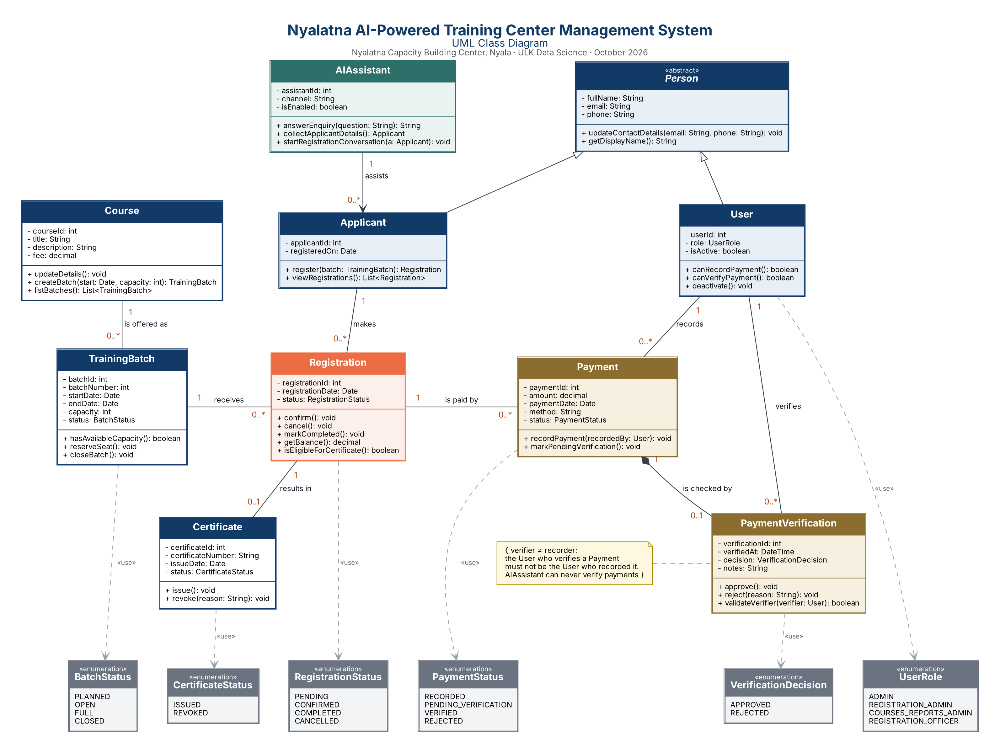

# Nyalatna AI-Powered Training Center Management System

**UML Class Diagram Modelling Assignment** · Kigali Independent University (ULK) · Lecturer: Eric Maniraguha · 19 October 2026

| Group member | Student ID |
|---|---|
| Mubarak Dawood Abdalla Bakheet | 202510537 |
| Mustafa Omer Mustafa Almubark | 202510734 |



## Business idea

Nyalatna Capacity Building Center is a training center in Nyala, South Darfur, Sudan. It runs professional courses in numbered cohorts called batches and has already graduated 16 batches. The business idea is an information system that manages the full path of an applicant: asking about a course, registering in a batch, paying fees, having each payment checked by a second staff member, and receiving a certificate. An AI assistant answers applicant enquiries and collects registration details, so staff spend less time on repeated questions.

## Problem

- Applicant details, course schedules, registrations and payments are kept in separate places (paper forms, spreadsheets and messaging apps), which leads to duplicated or incomplete records.
- Staff cannot easily see whether a batch still has free seats, so batches can be overbooked.
- The status of a registration (pending, confirmed, completed) is often unclear to both staff and applicants.
- Payments, including instalments, are recorded by hand. There is no clear rule for who checks a payment, so one person can record and approve the same payment, which creates a risk of errors or fraud.
- Staff spend a lot of time answering the same questions from applicants about courses, fees and dates.
- Certificates are issued manually, without a reliable link to completion and payment status.

## Purpose

The purpose of the system is to centralise applicant, course, batch, registration, payment and certificate records in one model, enforce batch capacity, and protect financial records through separation of duties: the staff user who records a payment cannot be the one who verifies it. An AI assistant handles routine applicant enquiries but is deliberately kept away from any payment decision.

## Scope

**Covered**

- Applicant and staff user profiles, with shared contact details modelled through an abstract Person class.
- Staff user accounts with roles (admin, registration admin, courses and reports admin, registration officer).
- Course catalogue with description and fee.
- Training batches with dates, capacity and status, including checking available seats.
- Registration of applicants in batches and tracking of registration status and balance.
- Recording of payments (full or instalments) by an authorised staff user.
- Independent verification of each payment by a different authorised staff user, with decision and notes.
- Issuing and revoking certificates for completed, eligible registrations.
- An AI assistant that answers enquiries and collects applicant details to start a registration.

**Not covered**

- Building a working application or database: this project is limited to analysis and UML design.
- Attendance tracking and session scheduling.
- Full accounting, payroll, and integration with banks or online payment gateways.
- Hosting learning content (videos, quizzes) for online courses.
- Rental of the center's halls and facilities.

## Classes

| Class | Responsibility |
|---|---|
| **Person** *(abstract)* | Abstract parent holding the name and contact details shared by applicants and staff users. |
| **Applicant** | A person applying for or attending a course. Registers in batches and follows their status. |
| **User** | A staff account with a role. Its role decides whether it may record or verify payments. |
| **Course** | A training programme in the catalogue, with its description and fee. |
| **TrainingBatch** | One scheduled offering (cohort) of a course, with dates, capacity and status. |
| **Registration** | Links one applicant to one training batch and tracks the registration status and balance. |
| **Payment** | A payment (full or instalment) recorded by a staff user against a registration. |
| **PaymentVerification** | The independent review of a payment by a second staff user, with the decision and notes. |
| **Certificate** | Proof of completion issued for an eligible, completed registration. |
| **AIAssistant** | Answers applicant enquiries and collects registration details. It has no access to payment verification. |

Enumerations: `BatchStatus` (PLANNED, OPEN, FULL, CLOSED); `RegistrationStatus` (PENDING, CONFIRMED, COMPLETED, CANCELLED); `PaymentStatus` (RECORDED, PENDING_VERIFICATION, VERIFIED, REJECTED); `VerificationDecision` (APPROVED, REJECTED); `UserRole` (ADMIN, REGISTRATION_ADMIN, COURSES_REPORTS_ADMIN, REGISTRATION_OFFICER); `CertificateStatus` (ISSUED, REVOKED).

## Relationships

| From | To | Type | Multiplicity | Meaning |
|---|---|---|---|---|
| Applicant | Person | Generalization | — | is a |
| User | Person | Generalization | — | is a |
| Course | TrainingBatch | Association | 1 → 0..* | is offered as |
| Applicant | Registration | Association | 1 → 0..* | makes |
| TrainingBatch | Registration | Association | 1 → 0..* | receives |
| Registration | Payment | Association | 1 → 0..* | is paid by |
| Payment | PaymentVerification | Composition | 1 → 0..1 | is checked by |
| User | Payment | Association | 1 → 0..* | records |
| User | PaymentVerification | Association | 1 → 0..* | verifies |
| Registration | Certificate | Association | 1 → 0..1 | results in |
| AIAssistant | Applicant | Directed | 1 → 0..* | assists |

A UML constraint note on PaymentVerification states the key rule. Full explanations are in Report 2.

## Business rules

- The staff user who verifies a payment must be different from the user who recorded it.
- Only users whose role allows it may record or verify payments.
- The AI assistant can never verify payments.
- A registration is refused when the batch is full; a certificate needs a completed, fully paid registration.

## Repository structure

```
uml-class-diagram-assignment/
│
├── README.md
│
├── documentation/
│   ├── report_1_project_description.pdf
│   └── report_2_uml_class_diagram.pdf
│
└── diagrams/
    ├── uml_class_diagram.drawio
    └── uml_class_diagram.png
```

| File | Contents |
|---|---|
| [Report 1](documentation/report_1_project_description.pdf) | Business idea, problem statement, scope, classes, requirements |
| [Report 2](documentation/report_2_uml_class_diagram.pdf) | Full diagram, classes with attributes and methods, relationships, multiplicities, explanations |
| [uml_class_diagram.drawio](diagrams/uml_class_diagram.drawio) | Editable diagram — open with [draw.io](https://app.diagrams.net) |
| [uml_class_diagram.png](diagrams/uml_class_diagram.png) | Exported image of the diagram |

> This project is limited to analysis and design. No application code is included.
